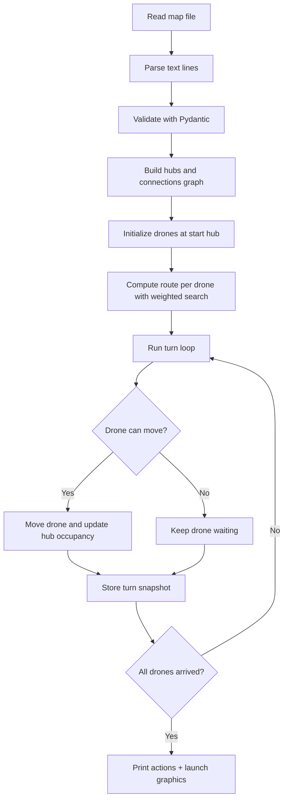

*This project has been created as part of the 42 curriculum by sgil--de.*

# Fly-in

> A graph-based drone routing and simulation project with an interactive 3D visualization.

---

## Table of Contents

1. [Description](#description)
2. [Project Structure](#project-structure)
3. [Input Format](#input-format)
4. [Instructions](#instructions)
5. [Algorithm Choices and Implementation Strategy](#algorithm-choices-and-implementation-strategy)
6. [Simulation Logic Schema](#simulation-logic-schema)
7. [Visual Representation and UX Features](#visual-representation-and-ux-features)
8. [Resources](#resources)

---

## Description

Fly-in simulates multiple drones traveling from a start hub to an end hub on a constrained graph.

The project has two goals:

- **Algorithmic goal**: compute valid and efficient routes while respecting hub capacities, link capacities, and zone traversal costs.
- **Visualization goal**: provide a clear real-time visual feedback of turns, drone movement, hub states, and map topology.

At runtime, the program:

1. Parses and validates a map file.
2. Builds the graph model (hubs + connections).
3. Computes and simulates turn-by-turn drone actions.
4. Prints textual turn output.
5. Launches a Ursina-based 3D visualization.

---

## Project Structure

| File | Role |
|---|---|
| `main.py` | Entry point, argument handling, orchestration |
| `parsing.py` | File reading, parsing, syntax checks |
| `validator.py` | Pydantic validation rules and defaults |
| `pathfinding.py` | Graph model, route search, turn simulation |
| `graphics.py` | 3D rendering, HUD, minimap, controls |
| `errors.py` | Custom exception and formatted error output |
| `maps/` | Test maps by difficulty |

---

## Input Format

Each map file is text-based and supports comments with `#`.

```txt
nb_drones: 5
start_hub: hub 0 0 [color=green]
end_hub: goal 10 10 [color=yellow]
hub: roof1 3 4 [zone=restricted color=red]
hub: roof2 6 2 [zone=normal color=blue]
connection: hub-roof1
connection: roof1-roof2 [max_link_capacity=2]
connection: roof2-goal
# Easy Level 1: Simple linear path
nb_drones: 2

start_hub: start 0 0 [color=green]
hub: waypoint1 1 0 [color=blue]
hub: waypoint2 2 0 [color=blue]
end_hub: goal 3 0 [color=red]

connection: start-waypoint1
connection: waypoint1-waypoint2
connection: waypoint2-goal
```

### Supported fields

- `nb_drones: <int>`
- `start_hub: <name> <x> <y> [metadata]`
- `end_hub: <name> <x> <y> [metadata]`
- `hub: <name> <x> <y> [metadata]`
- `connection: <name_a>-<name_b> [metadata]`

### Metadata defaults

| Key | Applies to | Default |
|---|---|---|
| `zone` | hubs | `normal` |
| `color` | hubs | `None` |
| `max_drones` | hubs | `1` |
| `max_link_capacity` | connections | `1` |

### Zone behavior

- `normal`: standard movement cost
- `restricted`: slower entry cost
- `priority`: lower effective cost in routing
- `blocked`: inaccessible (excluded from valid paths)

---

## Instructions

### Prerequisites

- Python `>= 3.10`
- `uv` installed

### Installation

```bash
uv sync
```

### Run with a map

```bash
uv run python main.py maps/easy/01_linear_path.txt
```

### Useful Make targets

```bash
make install
make run
make lint
make lint-strict
make clean
```

### Controls in visualization

- `right arrow`: next turn
- `left arrow`: previous turn
- `l`: show/hide graph connections
- `h`: toggle hub model colors to metadata colors
- `c`: toggle free camera / top orthographic camera

---

## Algorithm Choices and Implementation Strategy

### 1) Parsing and validation

- Parsing is line-oriented and metadata-aware.
- Validation is centralized with Pydantic models.
- Invalid inputs fail early with explicit error messages.

### 2) Data model

- A hub is a graph node with coordinates, zone, color, and capacity constraints.
- A connection is bidirectional and stores capacity and movement-related cost.
- Drones are stateful agents with current hub, wait counter, and a precomputed route.

### 3) Path strategy

I use a Dijkstra-like shortest-path traversal over hubs with weighted costs:

- base edge transition cost is derived from destination zone type;
- blocked zones are skipped;
- occupancy pressure adds a small dynamic penalty when a hub is near/over planned capacity.

This occupancy penalty encourages better distribution and reduces immediate bottlenecks while keeping the search deterministic and simple.

### 4) Turn simulation strategy

- Each turn, every unfinished drone executes one action.
- Drone movement is conditional on destination hub capacity.
- Restricted/priority timing is represented via `wait_turns`.
- Per-turn snapshots are persisted for replay and visualization.

### 5) Why this strategy

This architecture balances:

- **Correctness** (hard constraints checked every turn),
- **Clarity** (easy to inspect per-turn states),
- **Extensibility** (cost model can evolve without rewriting rendering code).

---

## Simulation Logic Schema



---

## Visual Representation and UX Features

### Scene representation

- Hubs are rendered as 3D blocks with zone-based models.
- Start/end hubs are highlighted with dedicated tower models.
- Terrain is generated as grass tiles around active map bounds.
- Optional links visualize the graph topology.

### Drone representation

- Drones are rendered as animated entities with smooth turn transitions.
- Vertical floating motion improves readability when multiple drones overlap.
- Minimap dots mirror drone positions per turn.

### HUD and minimap

- Hovering a hub opens a HUD panel with hub metadata (name, zone, capacity, coordinates, color).
- A minimap in UI space summarizes map geometry and real-time drone positions.
- Turn indicator displays current turn, total turns, hub count, and drone count.

### UX impact

These features make debugging and understanding algorithmic behavior much easier:

1. **Topology awareness** through optional links + minimap.
2. **Temporal understanding** via turn-by-turn navigation.
3. **Constraint visibility** with hub metadata on hover.
4. **Better readability** thanks to camera modes and smooth movement.

---

## Resources

### Core references

- [Pydantic documentation](https://docs.pydantic.dev/)
- [Ursina Engine documentation](https://www.ursinaengine.org/)
- [Python `heapq` documentation](https://docs.python.org/3/library/heapq.html)
- [Dijkstra shortest path reference](https://en.wikipedia.org/wiki/Dijkstra%27s_algorithm)

### AI usage statement

AI assistance was used as a **development helper**.

I used AI for:

- code cleanup and typing consistency (`mypy` / annotations),
- lint-oriented refactoring (`flake8` style fixes),
- documentation drafting and structure improvements,
- iterative UX polishing ideas for the visualization layer.
- parsing rules, validation behavior, algorithm choices, and rendering logic were reviewed and integrated manually.
